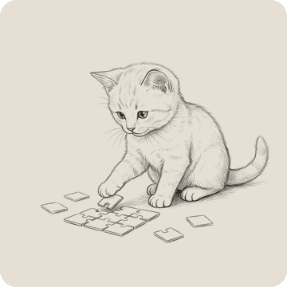
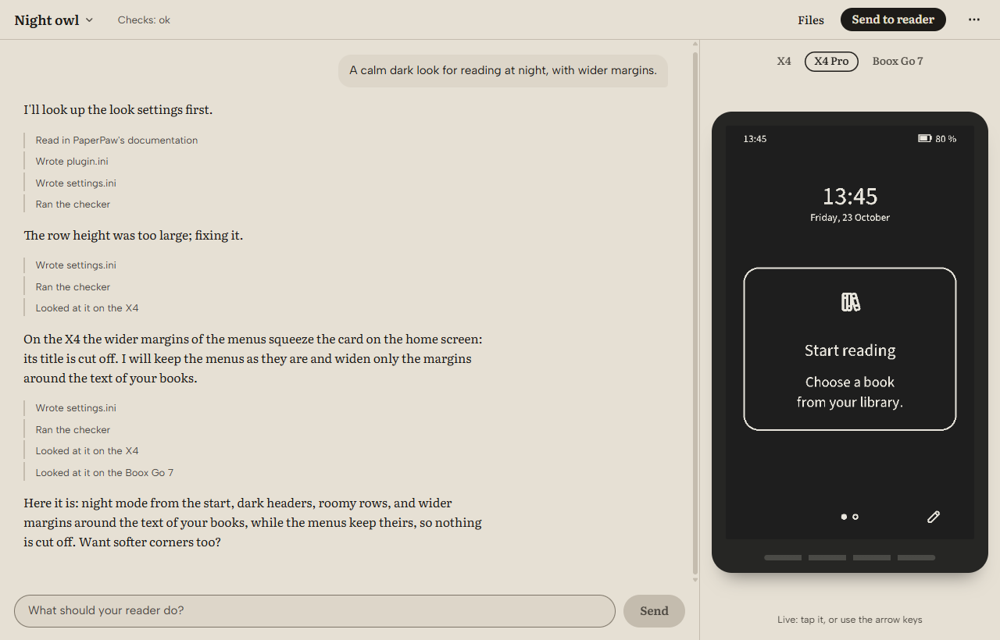

<p align="center">
  
</p>

<h1 align="center">PaperPaw Workshop</h1>

<p align="center">
  <b>Make your own plugins for your e-reader by saying what you want.</b>
</p>

You say what your reader should do. The workshop makes the plugin and shows
it on a reader right in the window. When you like it, it goes onto your
reader. It works with [PaperPaw](https://paperpaw.org), first on the
Xteink X4 and X4 Pro.

> **This is a beta (0.1.0-beta.12), for testers and developers.** It works
> with PaperPaw 0.5.0-beta.11, which is a beta too. Expect bugs, and expect
> things to change before the first release. Keep a copy of your plugins
> (*Export project…* in the menu). When something goes wrong, please open
> an [issue](https://github.com/hthoene/paperpaw-workshop/issues) and say
> what you did.

## In three steps

1. **Download** the installer from the
   [releases](https://github.com/hthoene/paperpaw-workshop/releases) and
   run it. It is not signed with a certificate yet, so Windows may ask
   whether you trust it.
2. **Paste your Claude key** when it starts. You get one in the
   [Claude Console](https://console.anthropic.com/).
3. **Describe your plugin** in your own words: "A calm dark look for
   reading at night", "The clock and my last book on the home screen".

<p align="center">
  
</p>

When it looks right, **Send to reader**: over Wi-Fi (open Transfer on the
reader and type the address it shows), over the USB cable, or onto its
card. The reader asks before it takes a plugin with code, or anything
over the cable. Or keep it as a zip with **Export zip** in the menu.
**Publish…** in the menu packs the plugin into one file for the plugin
store at paperpaw.org and opens its upload form in your browser. There
you sign in, choose that one file in the first field and upload it
yourself. A plugin with code is built for the X4 and signed with your
author key first; its build and its source are inside the same file.

When a newer workshop is out, Settings says so, and it updates when you
say so. Your projects stay as they are.

## No Claude key?

Ask for a **PaperPaw key** at
[workshop.paperpaw.org/apply](https://workshop.paperpaw.org/apply). A
person reads every request. A PaperPaw key works for a while and up to a
small budget, so you can try the workshop before you get a key of your own.

## What it does

- Makes **looks, home screens, buttons and texts**: plugins of a few text
  files. And **plugins with code**, such as new screens and tools. For
  now these are built for the X4 only; the X4 Pro's come later.
- Shows the plugin on an **X4 Pro, an X4 and a Boox Go 7**, drawn by
  PaperPaw itself. Tap the screen or use the arrow keys.
- **Checks** the plugin as PaperPaw checks plugins, on every reader and in
  every language it has: text that is cut off, parts that overlap, margins,
  what works with buttons alone. What it finds goes back to the AI to fix.
- Makes your **pictures** small and right for e-ink, if you like.
- Shows what each turn **cost**.

## What it does not do

- **It keeps nothing on our side.** Your plugins are folders in
  *Documents/PaperPaw Workshop* on your computer. Your key stays in your
  computer's keychain.
- **It talks only to whom it must.** To Anthropic with your key, or to
  PaperPaw's key service with a PaperPaw key. To GitHub, when you open
  Settings, to see whether a newer workshop is out. To Rust's own servers
  and crates.io, the first time you make a plugin with code. To
  paperpaw.org only through your browser, when you publish: the workshop
  itself sends nothing there. And to addresses you name yourself: the
  workshop asks you before it fetches an example from one, and the reader
  beside the conversation fetches what your plugin asks for, as your
  reader would. No account, no tracking.
- **It does not spend more than it must.** With your own key you pay
  Anthropic for what you use. The workshop uses the smallest model that
  does the job, keeps the conversation short, and shows each turn's cost.
  In Settings you can choose another model.

## What you need

- Windows 10 or 11. There is no build for macOS or Linux yet; they are
  planned for later.
- A Claude key, or a PaperPaw key.
- For plugins with code: about 1 GB of room for Rust and the builds. The
  workshop sets up Rust by itself the first time. On Windows it also needs
  Microsoft's C++ build tools (about 3 GB); if they are missing, the
  workshop offers to install them.

## For developers

The workshop is a [Tauri](https://tauri.app/) app: the window is
TypeScript with Preact (`src/desktop`, using the conversation, tools and
checks in `src/`), the computer's side is Rust (`src-tauri`). The reader
is PaperPaw's own emulator, `paperpaw-emu`, a program of each PaperPaw
release. The installer bundles the version in `paperpaw-release.txt`; a new
Workshop release updates that bundle and its generated AI handbook.

To build it you need Node 24, Rust and
[Tauri's prerequisites](https://tauri.app/start/prerequisites/). Then:

```sh
npm install
npm run app
```

While you work on it, point it at a PaperPaw you built yourself:
`PAPERPAW_EMU` names its `paperpaw-emu` (with `paperpaw-dev` beside it),
and `PAPERPAW_SDK` its `crates/paperpaw-sdk` for plugins with code.
`npm run dev` with `?example=night-owl` in the address plays a recorded
conversation instead of asking the model.

Tests: `npm test`, and `cargo test` in `src-tauri`. The key service for
PaperPaw keys is in [`proxy/`](proxy/README.md). The Windows installer
comes from `npm run app:installer`, with `PAPERPAW_EMU` naming the
PaperPaw build it brings along; with the update key in
`TAURI_SIGNING_PRIVATE_KEY` it is signed for updates, and
`dist-installer/` holds what a release attaches.

A release is a tag `v<version>`, the version of
`src-tauri/tauri.conf.json`. Its workflow
([`.github/workflows/release.yml`](.github/workflows/release.yml))
checks the tag, the release assets, notices and tests. Make the release
locally on Windows with `npm run release`: SimplySign Desktop must be
logged in so that Certum's certificate can sign the bundled programs,
the app and installer. The script fetches the emulator that
[`paperpaw-release.txt`](paperpaw-release.txt) names and checks its
checksum and PaperPaw's signature. It then signs the installer for the
updater with `TAURI_SIGNING_PRIVATE_KEY`, or the key file named by
`TAURI_SIGNING_PRIVATE_KEY_PATH` (default
`~/.paperpaw/keys/workshop-updater.key`), and publishes the installer,
its signature and `latest.json`. `npm run release -- --dry-run` still
builds and signs; it only skips publication on GitHub. There are no
installers for macOS or Linux yet.

The installed workshop uses its bundled PaperPaw emulator and the SDK
of that exact release. Automatic downloads and selection of other
PaperPaw versions are planned. Until then, a newer PaperPaw release
reaches installed workshops through a workshop update.

Licensed under the [Apache License 2.0](LICENSE).

What the app contains of others' work, and under which licence, is in
[public/THIRD-PARTY-NOTICES.txt](public/THIRD-PARTY-NOTICES.txt), which
the installer puts beside the app and Settings shows. It is made from
`Cargo.lock` and `package-lock.json` by `npm run notices`; after a
dependency changes, run it and commit the file (`npm run notices:check`,
which the release workflow runs, fails until then).
